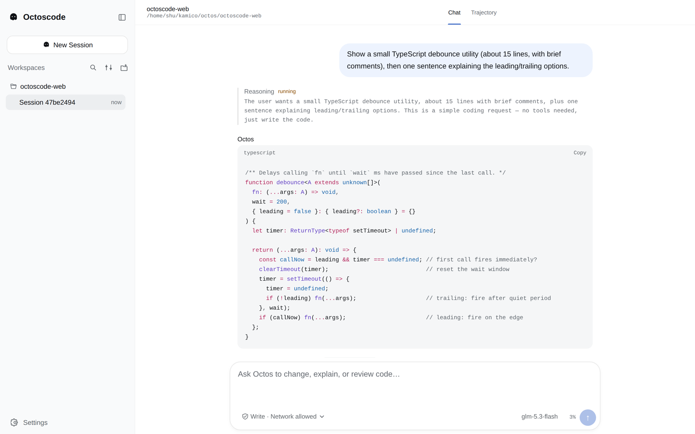
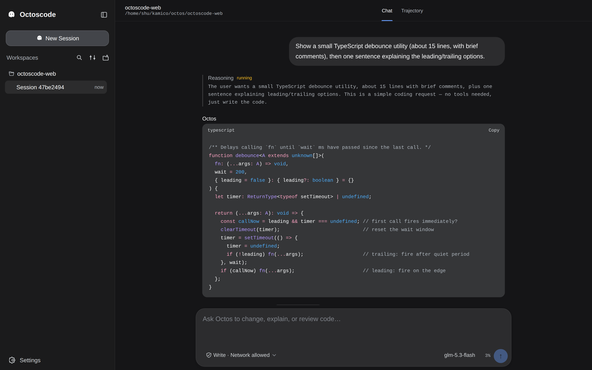

<div align="center">

# octoscode-web

**Octoscode, in the browser.**

A focused Web client for the Octos coding UI Protocol.

[](https://github.com/octos-org/octoscode-web/actions/workflows/ci.yml)
[](https://github.com/octos-org/octoscode-web/releases)
[](LICENSE)

[Get started](docs/getting-started.md) · [Documentation](docs/README.md) ·
[Releases](https://github.com/octos-org/octoscode-web/releases) ·
[中文](README.zh-CN.md)

</div>

octoscode-web brings the interaction model of
[Octoscode](https://github.com/octos-org/octoscode) to a browser workspace. It
is intentionally separate from the general-purpose
[`octos-web`](https://github.com/octos-org/octos-web) product.

| Coding session (light)                                                                                                                                           | Coding session (dark)                                                                  |
| ---------------------------------------------------------------------------------------------------------------------------------------------------------------- | -------------------------------------------------------------------------------------- |
|  |  |

```text
 Octoscode TUI ──┐
                 ├── Octos UI Protocol ── octos serve
octoscode-web ───┘                        agents · tools · sessions · tasks
```

The two clients share server-owned runtime truth. The Web app does not contain a
second agent loop, plugin host, sandbox, or session store.

## Code and Chat modes

The app has two modes, switched under **Work mode** at the top of the sidebar
(in the drawer on a phone):

- **Code**: pick a folder on the server and work in it. Needs Octos v2.0.3 or
  newer.
- **Chat**: everyday work without picking a folder, such as a weekly report or a
  cleaned-up list. Each chat gets its own folder that the server assigns. A new
  chat is read-only; **Allow file outputs** lets it save files, which you then
  preview and download under **Outputs**. Needs Octos v2.1.0 or newer.

From octoscode-web 1.0, both modes are on by default. **1.0 has not been
released yet.** Until it is, releases up to v0.22 have Code mode only, and
builds of `main` show Code only unless a tester turns on the Chat preview in
that browser. See [Use Chat mode](docs/getting-started.md#use-chat-mode).

- [Product scope](docs/product.md#code-and-chat-modes): what Chat mode does and
  how it is kept apart from Code.
- [1.0 release notes draft](docs/release-notes-1.0-draft.md) and
  [1.0 flag drill](docs/release-1.0-flag-drill.md): release preparation, in
  Chinese.

## What is included

- Octoscode-compatible launch, prompt queue, interrupt, approval, question,
  command, and session behavior.
- Durable hydrate, cursor replay, deduplication, gap recovery, and reconnect.
  Capability-gated turn-state checks preserve uncertainty without resending.
- Saved conversation links can reopen an exact server-confirmed reference in a
  new browser after authentication and explicit review.
- A DSH-aligned Workspace/Session sidebar with search, New Session, Add
  workspace, tab-confirmed Session navigation, and Settings.
- Concurrent retained Sessions on one pooled WebSocket, with independent prompt
  queues, approvals, questions, and native peer hosting while switching views.
  Enter steers a compatible running turn by default; Tab queues deliberately,
  and Send now interrupts the active turn to release pending input.
- Unread tab counts and opt-in desktop notifications when hidden or background
  responses finish or need attention.
- Session-local Chat and Trajectory views, safe Markdown/code rendering,
  approvals, questions, plans, tasks, output, artifacts, and diff review.
- In-conversation search (⌘F/Ctrl+F): live in-place highlighting, match
  navigation, case-sensitive matching, and two-stage Escape.
- Keep Changes before the first turn: review the session change preview and
  uncommitted workspace changes (with refresh) before asking for the next
  change.
- Server-advertised permission control and effective runtime-model status in the
  composer, plus capability-gated provider, model, route, credential, test,
  discovery, save/delete, and Profile-default management in Settings.
- A capability-gated Stop server control in Settings that stops a local
  `octos serve --solo` after confirmation, shown only when the server advertises
  `server/shutdown`.
- Browser onboarding for an empty solo server, with transient credentials and a
  truthful TUI fallback on older Core versions.
- Single-use pairing links, so connecting needs no pasted token, with the token
  optionally remembered per device and a Forget action.
- Server folder browsing when creating a workspace, including New folder, behind
  `onboarding.workspace_browse.v1`.
- Math in chat output through KaTeX, loaded only for messages that carry math.
- A responsive coding workspace informed by
  [DeepSeek Harness](https://github.com/deepseek-ai/deepseek-harness), with its
  MIT attribution preserved.

See [Product scope](docs/product.md) for the supported surface and deliberate
non-goals. The expanded parity implementation is a candidate: fixture and unit
passes do not establish complete TUI parity or acceptance of the live soak. See
[Feature parity](docs/feature-parity.md) for the acceptance boundary.

## Run locally

### First time, against a real Octos server

Five steps, from an empty home directory on Linux or a Mac. Pick a token — any
string — and use the same one everywhere.

You need:

- Git, curl, and Node.js 22 or newer.
- pnpm 11.5.2. On Node.js 22 or 24, `corepack enable` provides it; if that fails
  with a permission error, Node.js is installed for all users, so run it with
  `sudo` or use a per-user Node.js such as nvm. Node.js 25 and newer no longer
  include Corepack: run `npm install -g pnpm@11.5.2` instead.
- Octos v2.0.3 or newer for Code mode, v2.1.0 or newer for Chat mode. Step 1
  installs it.

**1. Install the Octos server.** Download the bundle for your computer from
[Octos releases](https://github.com/octos-org/octos/releases), check it, and
unpack it into `~/.octos/bin`:

```sh
VERSION=v2.1.0
ASSET=octos-bundle-x86_64-unknown-linux-gnu.tar.gz
mkdir -p ~/.octos/bin
cd "$(mktemp -d)"
curl -fLO "https://github.com/octos-org/octos/releases/download/$VERSION/$ASSET"
curl -fLO "https://github.com/octos-org/octos/releases/download/$VERSION/$ASSET.sha256"
sha256sum -c "$ASSET.sha256"
tar -xzf "$ASSET" -C ~/.octos/bin
~/.octos/bin/octos --version
```

On Linux ARM64, set `ASSET=octos-bundle-aarch64-unknown-linux-gnu.tar.gz`. On an
Apple silicon Mac, set `ASSET=octos-bundle-aarch64-apple-darwin.tar.gz` and
check it with `shasum -a 256 -c "$ASSET.sha256"`. Windows x64 has
`octos-bundle-x86_64-pc-windows-msvc.zip`; the commands here are for Linux and
macOS shells. v2.1.0 is the first Octos release with Chat mode; until it is
published, `VERSION=v2.0.3` gives you Code mode. `~/.octos/bin` is **not** added
to your `PATH`, so the commands below use the full path.

The [Octoscode TUI](https://github.com/octos-org/octoscode) also installs a
server into `~/.octos/bin` the first time it runs, but only the version that TUI
release was built for. Check it with `~/.octos/bin/octos --version`, and install
the bundle above if it is older than you need.

**2. Start the server:**

```sh
export OCTOS_AUTH_TOKEN=my-local-token
~/.octos/bin/octos serve --host 127.0.0.1 --port 50080 --solo
```

The server reads the token from `OCTOS_AUTH_TOKEN`. Do not also pass
`--auth-token`: it puts the token in the process list, and the server warns
about that. `--solo` lets this app create your profile on first run. Without it
a fresh server answers "This server cannot onboard from the Web". The server
keeps its data in `~/.octos`.

**3. Get and start this app**, in another terminal:

```sh
git clone --branch v1.0.0 https://github.com/octos-org/octoscode-web.git
cd octoscode-web
pnpm install --frozen-lockfile
pnpm build
OCTOSCODE_DEV_PROXY_TARGET=http://127.0.0.1:50080 \
OCTOSCODE_DEV_PROXY_ORIGIN=http://127.0.0.1:50080 \
pnpm --filter @octos-org/octoscode-web exec vite preview --host 127.0.0.1
```

`--branch` picks a release;
[Releases](https://github.com/octos-org/octoscode-web/releases) lists them, and
`main` is unreleased work. Until 1.0 is published, use `--branch v0.22.0`, which
has Code mode only. Each release also has an archive,
`octoscode-web-<tag>.tar.gz`, with the same app already built, for hosting
behind a web server; see [Deployment](docs/deployment.md).

With Corepack, run `corepack install` in the checkout before `pnpm install`. It
downloads the pnpm version the repository pins, without asking. Skip it and the
first pnpm command asks
`Corepack is about to download https://registry.npmjs.org/pnpm/-/pnpm-11.5.2.tgz`
and `Do you want to continue? [Y/n]`: answer `Y`. That is a one-time download,
not an error.

Keep both `OCTOSCODE_DEV_PROXY_*` variables. They make the browser talk only to
this app's own address, which forwards to the server. Leave them out and the
server refuses the browser, because by default it trusts only its own address —
and the page reports a connection failure that blames your server and token,
though both are fine.

**4. Open <http://127.0.0.1:4173>**, the address step 3 prints. Leave **Server
origin** as it is, paste the token into **Auth token**, and select **Connect**.
Under **Add workspace** enter a project folder's full path, or select
**Browse…**, then select **Start session**. The first time, **Set up your coding
assistant** opens:

1. **Step 1 of 2 · Model service**: choose a provider and a **Model**, then
   select **Continue**. You can leave **Advanced** closed: it holds the
   profile's ID, which is `coding` unless you change it.
2. **Step 2 of 2 · Connect**: paste the provider's API key and select **Test,
   save & open**. The key is tested with the provider before anything is saved.
   Octos keeps it; the browser does not.

The conversation then opens. For a Kimi Coding Plan key, see
[Kimi](docs/getting-started.md#kimi). For Chat mode, see
[Use Chat mode](docs/getting-started.md#use-chat-mode).

**5. Optionally attach the terminal too:**

```sh
OCTOS_AUTH_TOKEN=my-local-token octoscode \
  --endpoint ws://127.0.0.1:50080/api/ui-protocol/ws --profile-id coding
```

If you changed the profile ID in step 4, use yours. It reports "Pass --session
to open an interactive session." That is expected: type `/resume` to join the
conversation from the browser. See
[Share a session with the terminal](#share-a-session-with-the-terminal).

| You see                                                                        | Fix                                                                                                      |
| ------------------------------------------------------------------------------ | -------------------------------------------------------------------------------------------------------- |
| `command not found: octos`                                                     | Use the full path, `~/.octos/bin/octos`                                                                  |
| `corepack: command not found`                                                  | Node.js 25 and newer: `npm install -g pnpm@11.5.2`                                                       |
| Corepack asks `Do you want to continue? [Y/n]`                                 | Answer `Y`: it downloads pnpm once. `corepack install` in the checkout does it without asking            |
| pnpm warns that the `"pnpm"` field in package.json is no longer read (v0.22)   | Harmless: the lockfile pins the same versions. Later releases keep that setting in `pnpm-workspace.yaml` |
| `sha256sum: command not found` on a Mac                                        | `shasum -a 256 -c "$ASSET.sha256"`                                                                       |
| "This server cannot onboard from the Web"                                      | Restart the server with `--solo`                                                                         |
| A connection failure, though the server runs and token is right                | Restart step 3 with both `OCTOSCODE_DEV_PROXY_*` variables set                                           |
| **Chat** is disabled and says the server cannot give every chat its own folder | The server is older than v2.1.0: install v2.1.0 (step 1) and restart it                                  |
| Nothing to pick after `/resume` in the terminal                                | Send one message in the browser first; a session lists once it has a turn                                |

Serving this app somewhere without that proxy? Tell the server to trust its
address: `OCTOS_APPUI_ALLOWED_ORIGINS=http://<host>:<port>` on the server, or
`appui.allowed_origins` in its config.

To upgrade either part or go back to an earlier release, see
[Upgrade or roll back](docs/getting-started.md#upgrade-or-roll-back).

### Developing this app

To work on the app against a real server, run `pnpm dev` in place of
`pnpm build` and the preview in step 3, with the same two variables. It serves
the same address and reloads as you edit.

Without Octos, a deterministic fixture can stand in for the server. It listens
on port 50080 by default — the same port as step 2 — so run one or the other, or
move the fixture with `OCTOSCODE_MOCK_PORT`:

```sh
pnpm install --frozen-lockfile
pnpm mock:server   # terminal 1
pnpm dev           # terminal 2
```

Open the app, set **Server origin** to `http://127.0.0.1:50080`, type any value
into **Auth token** — the form requires one, but the fixture accepts anything —
and connect.

### The server must be listening on a port

A browser can only reach Octos over HTTP, so `octos serve` has to be bound to a
host and port, as in step 2 above.

**Not `--stdio`.** That mode runs the UI Protocol over the process's stdin and
stdout _instead of_ binding HTTP, so it serves exactly one client — the one that
spawned it — and no browser can attach. It is what the
[Octoscode TUI](https://github.com/octos-org/octoscode) uses by default when you
run it on its own.

Pick the mode by what you want in front of you:

| You want                              | Run                                                                                                        |
| ------------------------------------- | ---------------------------------------------------------------------------------------------------------- |
| Just a terminal, nothing to configure | `octoscode` on its own — it provisions a server and speaks stdio to it                                     |
| A browser                             | `octos serve --host … --port …`, then this app                                                             |
| Both at once                          | the same `octos serve`, then this app **and** `octoscode --endpoint ws://<host>:<port>/api/ui-protocol/ws` |

The third row is a real configuration, not a workaround: the terminal and the
browser are peers on one server. See
[Share a session with the terminal](#share-a-session-with-the-terminal).

### Connecting

Run `octos serve` separately. There are two ways to connect it.

**From a pairing link, when the server offers one.** Start the server with the
address this app is served from. The link connects the page to the server
directly, not through the proxy of step 3, so the server must also trust that
address:

```sh
export OCTOS_AUTH_TOKEN=my-local-token
OCTOS_APPUI_ALLOWED_ORIGINS=http://127.0.0.1:4173 \
  ~/.octos/bin/octos serve --host 127.0.0.1 --port 50080 --solo \
  --web-url http://127.0.0.1:4173
```

It prints one line:

```
Open the web client: http://127.0.0.1:4173/?octos=http://127.0.0.1:50080&pair=EMX3MBRB
```

Open that link in the app built in step 3 and it connects on its own. Without
`OCTOS_APPUI_ALLOWED_ORIGINS` the page says it could not reach the server. The
development server (`pnpm dev`) currently reports a fresh link as already used;
connect by hand there. The code works once, expires five minutes after the
server starts, and is only accepted over loopback. The link's parameters are
removed from the address bar before the first render. The page also suppresses
referrers while its resources load. The auth token stays in this browser tab; it
is never saved to localStorage. **Cancel** stops the current claim, and **Forget
saved connection** removes this tab's saved connection and any legacy device
token. Without `--web-url`, servers supporting pairing print their origin and
code as separate labelled lines instead.

**By hand, which always works.** Enter the server's origin and auth token. The
connection form defaults to this page's origin; **Use this page** restores that
address after a custom server was saved. A server that does not offer pairing
shows this form with no extra step.

Then choose where the session runs: type a path on the Octos server, or select
**Browse…** to walk the server's folders, which appears when the server
advertises `onboarding.workspace_browse.v1`. The browser lists subfolders only,
goes up and down, and **New folder** creates one and moves into it. Select
**Start session** to open the conversation. For later conversations, **New
Session** offers recent Workspaces and **Add workspace**. The sidebar remembers
the Sessions this tab successfully opens, so multiple conversations in the same
Workspace remain distinct and can be selected again. The selected Session is
restored on refresh in the same tab. Unsent composer drafts also survive closing
the tab: sign in again and open the same Session to restore its text. Drafts
stay scoped to the server, authenticated user and Session; they are never sent
automatically after restoration. These confirmed references are navigation
memory, not a complete Session catalog: Core rc.9 can misroute
`session/list({cwd})` for unscoped/admin connections, so the Web client cannot
promise a complete or correctly grouped catalog until the server-owned
SessionRef contract in
[octos#2146](https://github.com/octos-org/octos/issues/2146) lands. The browser
cannot start or provision the Octos binary.

Switch or create Sessions while other Sessions are running, starting, waiting,
or holding queued prompts. Each confirmed Session retains its own controller,
FIFO, interactions, cursor, and bounded transcript projection; selecting another
view does not move or discard that work. All records share one physical
WebSocket, replacing the old eight-owner-connection limit and ACK navigation
guard. Native peer Sessions are hosted without selecting them.

This is not detached server execution. Core rc11 still interrupts
connection-owned work when the pooled socket closes: refresh, tab close,
network/proxy loss, or **Disconnect** can stop running turns. Same-tab reconnect
retains local queues but must reconcile each Session through hydrate/replay
before dispatch; a page reload loses queued prompts and attachment drafts. A
browser leave warning helps prevent accidental refresh or close while work is
active. Disconnect keeps confirmed navigation refs, not live records. **Forget
server** or an endpoint/token change clears those refs. The current downloadable
runtime baseline is recorded in
[`core-runtime.json`](packages/client/core-runtime.json); earlier rc.9/rc.11
audit results remain tied to their tested revisions. Durable detached execution
remains a Core boundary, tracked in
[octos#2167](https://github.com/octos-org/octos/issues/2167).

The architecture decisions cover
[retained Sessions on one transport](docs/adr/0020-retained-sessions-on-a-shared-transport.md),
[user-scoped draft persistence](docs/adr/0021-user-scoped-durable-composer-drafts.md),
and [on-demand Activity](docs/adr/0022-activity-for-confirmed-sessions.md).

### Share a session with the terminal

One `octos serve` accepts many clients. Point the
[Octoscode TUI](https://github.com/octos-org/octoscode) at the same server, with
the same token, and both are live against the same agent, sessions and
workspace:

```sh
export OCTOS_AUTH_TOKEN=my-local-token
octoscode --endpoint ws://127.0.0.1:50080/api/ui-protocol/ws
```

Like the server, the TUI reads the token from `OCTOS_AUTH_TOKEN`.

Add `--session <id>` to open one specific conversation in both places. Each
client's `session/open` is an _attach_, not a claim, and the server fans every
event for that session out to every connection that opened it — so a turn
started in the terminal streams into the browser as it happens, and the reverse.

Two rules follow from that, and they are the server's, not this app's:

- **One turn at a time per session.** The server keeps a single active-turn slot
  per session. While one client's turn is running, the other's `turn/start` is
  refused rather than queued server-side.
- **Nothing decides who "owns" a session.** Both clients may start turns
  whenever the slot is free, and any attached client can interrupt the running
  turn — `turn/interrupt` is not scoped to the connection that started it. If
  you want one side to watch only, start the TUI with `--readonly`, which
  disables its sends.

For UI work without a local Octos installation, start the deterministic AppUI
fixture in another terminal:

```sh
pnpm mock:server
```

The [getting-started guide](docs/getting-started.md) explains both paths.

## Documentation

| Read this                                  | When you need to…                                    |
| ------------------------------------------ | ---------------------------------------------------- |
| [Getting started](docs/getting-started.md) | run the app or connect a server                      |
| [Product scope](docs/product.md)           | understand features, boundaries, and roadmap         |
| [Architecture](docs/architecture.md)       | understand ownership and package boundaries          |
| [Protocol integration](docs/protocol.md)   | change transport, projections, or Core compatibility |
| [Deployment](docs/deployment.md)           | host or roll back a release safely                   |
| [Testing](docs/testing.md)                 | choose verification gates and diagnose flakes        |
| [Troubleshooting](docs/troubleshooting.md) | resolve connection, recovery, and command issues     |
| [Releasing](docs/releasing.md)             | publish and verify immutable releases                |
| [ADR index](docs/adr/README.md)            | find the reasoning behind durable decisions          |

The [documentation index](docs/README.md) is the complete map. Contributors
should also read [CONTRIBUTING.md](CONTRIBUTING.md) and
[SECURITY.md](SECURITY.md).

## Project layout

```text
apps/web          React application and feature UI
packages/client   React-free JSON-RPC/WebSocket client
e2e               Playwright product, recovery, responsive, and WCAG flows
scripts           Contract, policy, deployment, and real-Core verification
deploy            Checked same-origin nginx production reference
.github/workflows CI and immutable provenance-attested release automation
docs              product, architecture, protocol, and deployment guides
docs/adr          accepted architectural decisions
```

## Verify a change

```sh
pnpm check
pnpm contract:verify
pnpm exec playwright install chromium
pnpm test:e2e
```

Compatibility changes should also pass the pinned real-Core integration gate;
see [Protocol integration](docs/protocol.md#compatibility-gates).

## License

Apache-2.0. Copied or substantially adapted third-party work is recorded in
[THIRD_PARTY_NOTICES.md](THIRD_PARTY_NOTICES.md); the generated production
dependency closure is recorded in
[THIRD_PARTY_LICENSES.md](THIRD_PARTY_LICENSES.md).
